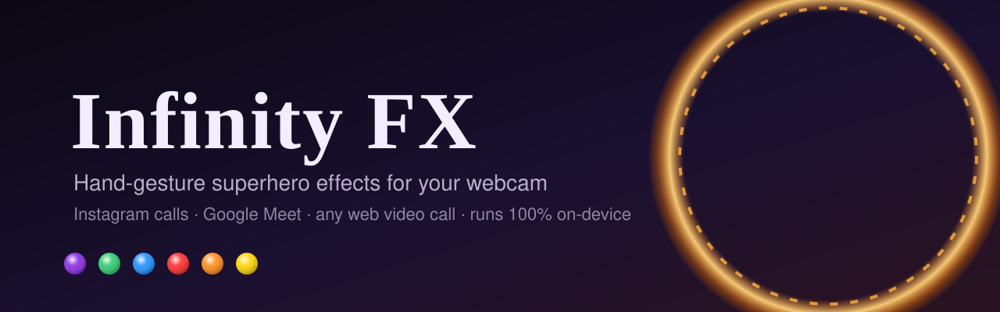

<p align="center"></p>

<p align="center">
  
  
  
  
</p>

**Infinity FX** is a Chrome extension that turns hand gestures into cinematic, superhero-style effects on your webcam, live, during real calls. Snap your fingers and you crumble to ash, leaving an empty room behind. Draw a circle in the air and a sparking portal opens behind you onto the Shanghai skyline. Everyone on the call sees it, because the extension processes the camera stream itself.

It runs entirely on your machine. Hand and body tracking use Google's MediaPipe models in WebAssembly and WebGL, and no video ever leaves your computer except through the call itself.

## Effects

| Gesture | Effect |
|---|---|
| 🫰 **Hold the snap pose** | The six Infinity Stones light up on your knuckles and palm, and the snap is now armed |
| 🫰 **Snap** | White flash and shockwave, then you dissolve into drifting ash. The room stays and you are fully invisible. Snap again to reassemble |
| ☝️ **Draw a circle with your index finger** | A sparking portal pops open, glides behind you and grows into a huge window onto **Shanghai at night**, your own picture, or the Mirror Dimension. Circle again to close |
| 🖐️ **Hold an open palm toward the camera** | A repulsor charges in your palm and an arc reactor lights up on your chest |
| 🖐️ **Push the palm at the camera** | Repulsor blast with a flash and screen shake |
| ✊ **Raise a fist above your head** | Lightning strikes your fist, arcs crawl over your outline and your eyes glow |
| ✌️ **Hold a peace sign** | Toggles a flickering blue hologram of you, projected into your room |
| 🤞 **Cross your index and middle finger, hold** | **Jujutsu Kaisen: Domain Expansion.** A black barrier bursts from your hand and the room becomes Gojo's Infinite Void, a cosmic rush of light. Your eyes burn blue and 領域展開 / 無量空処 slams in. Cross again to collapse it |
| 🙌 **Lift both open hands upward** | **Solo Leveling: ARISE.** The picture goes violet, a System window pops up, and shadow soldiers with burning eyes rise from the floor behind you while a shadow aura pours off you |
| 🎥 **Turn your camera on** | You arrive through a portal: a sling ring sparks up in the dark, then opens on you |

Each effect can be switched off in the popup. Each one also has a keyboard backup: <kbd>Alt</kbd>+<kbd>Shift</kbd> with <kbd>S</kbd> snap, <kbd>P</kbd> portal, <kbd>R</kbd> repulsor, <kbd>T</kbd> Thor, <kbd>H</kbd> hologram, <kbd>E</kbd> leave or arrive through a portal, <kbd>G</kbd> Domain Expansion, <kbd>A</kbd> ARISE.

## Install

1. Download this repository (**Code → Download ZIP**) and unzip it, or `git clone` it.
2. Open `chrome://extensions` and switch on **Developer mode**.
3. Click **Load unpacked** and choose the `extension` folder.
4. Pin Infinity FX from the puzzle-piece menu, then reload any open call tab.

Works in Chrome or any Chromium browser, version 116 or newer. On Instagram, use calls on **instagram.com in a desktop browser**, because the mobile app can't run extensions.

## Tips for the best result

- **Let it learn your room.** Step out of frame for about three seconds once. Infinity FX saves a photo of your empty room and reuses it, so the vanish shows the real wall behind you, not a guess. You can clear it with **Forget** in the popup if you move the camera.
- **Good light, whole hand in view.** Gestures come from hand tracking. Turn on **Show tracking** in the popup to see what it detects, and note that the other side sees it too.
- **Turn off the call's own background blur.** It runs after Infinity FX and blurs the effects as well.
- **Snaps missed or misfiring?** Set snap sensitivity to High or Low. The mic is also used, locally, to hear the click of a snap.

## How it works

```
call site (Meet / Instagram)            hidden extension iframe
┌─────────────────────────────┐        ┌──────────────────────────────────────┐
│ getUserMedia() ── patched ──┼─frame─▶│ MediaPipe hands + pose + segmentation│
│ camera track → processor    │        │ gesture recognizer                   │
│ generator ◀─────────────────┼◀frame──│ effects compositor (OffscreenCanvas) │
│ → the call sends this track │        └──────────────────────────────────────┘
└─────────────────────────────┘
```

A content script in the page's own JavaScript world wraps `getUserMedia`, so the call receives a processed camera track. Frames are sent to a hidden extension iframe, where MediaPipe's WebAssembly can run under the extension's own security policy. That iframe tracks your hands and body, recognises gestures, composites the effects and sends the frames back. See [docs/ARCHITECTURE.md](docs/ARCHITECTURE.md) for the full design.

**Highlights**
- **Background plate.** It keeps learning an image of your room without you in it, and fills the never-seen area behind you by row-wise interpolation. That is what makes the vanish leave a clean empty room.
- **Real-time particles on a 2D canvas.** About 48k ash particles are written straight into a pixel buffer, with pooled additive glow sprites for sparks.
- **Procedural art, no image assets.** The Shanghai skyline, the gauntlet, the lightning and the portal ring are all drawn in code.
- **Resilient pipeline.** Black frames are sent until the engine is ready, the last effect frame repeats if the engine runs late, and the plain camera goes out if anything fails.

## Project layout

```
extension/            the Chrome extension (load this folder)
  manifest.json
  inject.js           page world: wraps getUserMedia, frame transport, snap sound
  bridge.js           isolated world: creates the engine iframe, mirrors settings
  engine.html/.js     MediaPipe + per-frame orchestration and compositing
  gestures.js         snap, pinch, point, circle, palm, thrust, fist-up, peace
  fx/                 one module per effect + shared helpers
  popup.html/.js      settings UI
  lib/, models/       MediaPipe runtime and models (third-party, Apache-2.0)
docs/                 architecture, development guide, media
tools/visual-test/    headless Chrome harness with a fake camera
scripts/              check and package scripts
```

## Development

No build step and no dependencies. Edit the files, then press reload on `chrome://extensions`.

```sh
npm run check      # syntax-check all JS and the manifest
npm run package    # build dist/infinity-fx-<version>.zip
```

[docs/DEVELOPMENT.md](docs/DEVELOPMENT.md) covers debugging, the headless visual test harness and how to add a new effect.

## Privacy

Everything runs locally. Infinity FX has no servers, no analytics and no network requests of its own. The only permission it asks for is `storage`, for your settings. Microphone audio is analysed in memory only to detect the click of a finger snap, and is never recorded or sent anywhere.

## Credits

Inspired by a "Thanos snap in Google Meet" extension that was shared as an Instagram reel. Built on [MediaPipe](https://github.com/google-ai-edge/mediapipe) by Google, see [THIRD_PARTY_NOTICES.md](THIRD_PARTY_NOTICES.md).

This is an unofficial fan project. It is not affiliated with Marvel, Disney, Instagram, Meta or Google.

## License

[MIT](LICENSE)
